<h3><code>TienThanhUs@github ~ $ ./leetcode-stats.sh</code></h3>

  
<h3><code>TienThanhUs@github ~ $ whoami</code></h3>
<table>
<tr>
<td valign="top"></td>
<td valign="top"></td>
</tr>
</table>
 
<h3><code>TienThanhUs@github ~ $ cat tech-stack.yml</code></h3>

